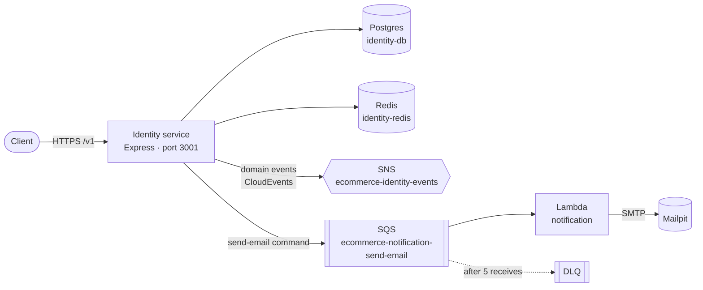

# E-commerce Microservices

Backend for an e-commerce platform built as **microservices** in TypeScript. Each service follows a **hexagonal architecture**. Services talk to each other over **HTTP** and through **events and commands** (SNS/SQS), and event-driven workers run on **AWS Lambda**. All AWS resources are provisioned with **Terraform** and run locally on Floci, an AWS emulator.

## Architecture



- **Hexagonal architecture**: in every service, `domain` → `application` (use cases + ports) → `adapters/in|out`, with a `main.ts` composition root that wires dependencies by hand. Dependencies always point inward.
- **Hybrid compute**: core services run in containers; event-driven workers run as Lambdas.
- **Database per service**: each service has its own Postgres and its own Redis.
- **Shared contracts, not shared logic**: `packages/` holds only contracts and cross-cutting configuration, never business rules.
- **Events vs commands**: domain events (past-tense facts) are fanned out through SNS. Commands (intents) go point-to-point to a dedicated SQS queue.

## Services

### Identity (`apps/identity`)

Registration, authentication and session management.

| Method | Path                            | Description                                                  |
| ------ | ------------------------------- | ------------------------------------------------------------ |
| POST   | `/v1/auth/register`             | Register a user (always `202`, anti-enumeration)             |
| POST   | `/v1/auth/verify-email`         | Confirm an email with a one-time token                       |
| POST   | `/v1/auth/login`                | Issue an access token + refresh token                        |
| POST   | `/v1/auth/refresh`              | Rotate the refresh token                                     |
| POST   | `/v1/auth/logout`               | Revoke the session                                           |
| POST   | `/v1/auth/forgot-password`      | Request a password reset email (always `202`)                |
| POST   | `/v1/auth/reset-password`       | Set a new password with a one-time token                     |
| GET    | `/v1/users/me`                  | Current user (requires `Authorization: Bearer`)              |
| GET    | `/.well-known/jwks.json`        | Public keys used to validate access tokens                   |
| GET    | `/health/live`, `/health/ready` | Liveness and readiness (readiness checks Postgres and Redis) |

Highlights:

- **Access tokens**: JWT signed with **ES256** that expire after 15 minutes. Other services validate them locally through the JWKS endpoint, without calling Identity on each request.
- **Refresh tokens**: opaque tokens, **rotated on every use**, and only their SHA-256 hash is stored. If an already-used token is presented again, the whole session is revoked (theft detection).
- **Passwords**: bcrypt with cost 12, enforcing bcrypt's 72-byte input limit.
- **Brute-force protection** in Redis: 20 attempts per minute per IP. After 5 failures in 15 minutes, the account is locked for 15 minutes.
- **Anti-enumeration**: neutral responses and equalized timing on register and forgot-password.
- **Errors** follow RFC 9457 Problem Details (`application/problem+json`).

### Notification (`functions/notification`)

A Lambda that consumes `send-email` commands from SQS and delivers them over SMTP. It uses **partial batch responses**, so only the failed records go back to the queue, and they move to a DLQ after 5 receives. One-time tokens are never logged.

## Contracts

- **REST**: versioned in the URL (`/v1`), JSON in `camelCase`, money as integer cents + currency.
- **Messages**: [CloudEvents 1.0](https://cloudevents.io/) envelope with types named `com.ecommerce.<service>.<aggregate>.<fact>.v<N>`. The Zod schemas live in [`@ecommerce/event-contracts`](packages/event-contracts), and producers validate every message before sending it.
- **IDs**: UUIDv7, generated by the application.
- **Correlation id**: propagated from the HTTP request (`x-correlation-id`) through SNS/SQS to the Lambda.

## Tech stack

| Area           | Choice                                                             |
| -------------- | ------------------------------------------------------------------ |
| Runtime        | Node.js 24, TypeScript 7, ESM                                      |
| HTTP           | Express 5                                                          |
| Validation     | Zod (HTTP input, messages, env config)                             |
| Persistence    | PostgreSQL 18 + Sequelize, Umzug migrations                        |
| Cache          | Redis 8 (node-redis)                                               |
| Messaging      | AWS SNS + SQS (AWS SDK v3)                                         |
| Serverless     | AWS Lambda, bundled with esbuild                                   |
| Infrastructure | Terraform, Docker Compose, Floci (local AWS)                       |
| Logging        | Pino with redaction of secrets                                     |
| Tests          | Vitest, Testcontainers                                             |
| Tooling        | pnpm workspaces, Turborepo, oxlint, Prettier, lefthook, commitlint |

## Repository layout

```
.
├── apps/identity/            # Identity service (container)
├── functions/notification/   # send-email Lambda
├── packages/
│   ├── event-contracts/      # Zod schemas + CloudEvents
│   └── tsconfig/             # shared strict tsconfig
├── infra/
│   ├── docker/               # compose: Postgres, Redis, Floci, Floci UI, Mailpit, Terraform
│   └── terraform/            # SNS, SQS + DLQ, Lambda, IAM
├── api/bruno/                # Bruno collection for manual API calls
├── docs/
│   ├── adr/                  # Architecture Decision Records
│   └── domain/               # domain models and diagrams
└── STYLE_GUIDE.md            # coding and API conventions
```

## Getting started

**Prerequisites:** Node.js 24+, pnpm 12, Docker.

```bash
pnpm install

# 1. Local infrastructure (Postgres, Redis, Floci, Mailpit)
cp infra/docker/.env.example infra/docker/.env
pnpm infra:up

# 2. AWS resources on Floci (builds the Lambda, then terraform apply)
pnpm infra:provision

# 3. Identity service
cp apps/identity/.env.example apps/identity/.env
pnpm -s --filter @ecommerce/identity keys:generate >> apps/identity/.env
pnpm --filter @ecommerce/identity db:migrate
pnpm dev:identity             # http://localhost:3001
```

| Local endpoint         | URL                   |
| ---------------------- | --------------------- |
| Identity API           | http://localhost:3001 |
| Mailpit (emails)       | http://localhost:8025 |
| Floci UI (AWS console) | http://localhost:4500 |
| Floci (AWS API)        | http://localhost:4566 |

Ports follow a convention: Postgres `54NN`, Redis `63NN` and service HTTP `30NN`, where `NN` is the service number (`01` = identity).

To try the API manually, open `api/bruno/` in [Bruno](https://www.usebruno.com/) and select the `local` environment.

## Scripts

| Command                                        | Description                                             |
| ---------------------------------------------- | ------------------------------------------------------- |
| `pnpm build`                                   | Build all packages                                      |
| `pnpm typecheck`                               | Type-check all packages                                 |
| `pnpm test`                                    | Unit tests                                              |
| `pnpm test:integration`                        | Integration tests with Testcontainers (requires Docker) |
| `pnpm lint` / `pnpm format`                    | Lint / format                                           |
| `pnpm infra:up` / `infra:down` / `infra:reset` | Start / stop / wipe local infrastructure                |
| `pnpm infra:provision`                         | Build the Lambda and apply Terraform on Floci           |
| `pnpm infra:tf <args>`                         | Run any Terraform command                               |

## Testing

- **Unit tests** cover the domain, use cases, adapters and HTTP layer, using in-memory fakes instead of mocks.
- **Integration tests** run the adapters against real Postgres, Redis and SNS/SQS on Floci, started by Testcontainers.
- **Contract tests** validate messages against the shared Zod schemas.

## Roadmap

- Transactional Outbox for reliable event publishing
- Optimistic locking for concurrent refresh-token rotation
- Idempotent message consumers (deduplication store)
- Catalog, cart, orders, inventory and payments services
- API Gateway as the single entry point
- Checkout saga (choreography and orchestration with Step Functions)
- Redis cache-aside with event-driven invalidation
- Observability with OpenTelemetry (traces, metrics, structured logs)

## Documentation

- [Style guide](STYLE_GUIDE.md): conventions for code, APIs, events and Git
- [Architecture Decision Records](docs/adr/)
- [Identity domain model](docs/domain/identity.md)
