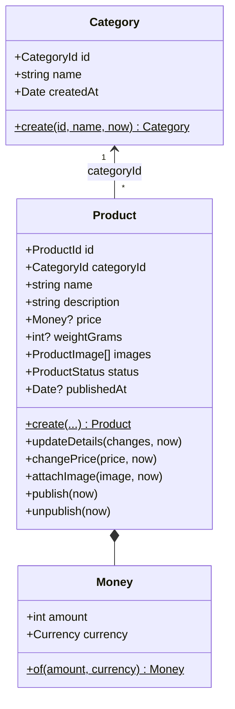
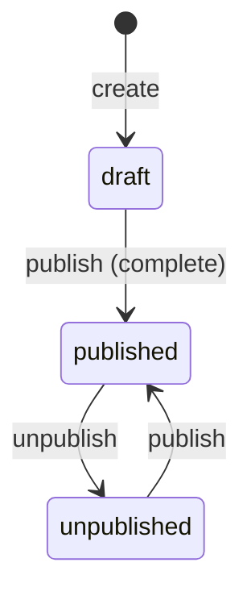

# Catalog — Domain Model

Bounded context responsible for **what the store sells**: categories, products, prices, weights and images, and whether a product is on the storefront. Stock levels belong to Inventory; coupons to Promotions. Process-level flows are in [`event-storming.md`](event-storming.md#process-level--catalog-images-stock-and-coupons-admin).

## Ubiquitous language

| Term          | Meaning                                                                         |
| ------------- | ------------------------------------------------------------------------------- |
| **Category**  | A flat grouping of products, used to filter the storefront.                     |
| **Product**   | Something the store sells. Starts as a draft; visible only when published.      |
| **Draft**     | A product being prepared by an admin; may be incomplete.                        |
| **Publish**   | Put a complete product on the storefront.                                       |
| **Unpublish** | Take a product off the storefront without deleting it.                          |
| **Price**     | `Money` in integer cents, BRL only.                                             |
| **Image**     | A processed image in S3 (key), attached after the upload pipeline validates it. |

## Aggregates

- Two aggregates, referenced **by id**: they change for different reasons, and a category with thousands of products must not be loaded (or locked) to change one price.
- Whether a product's `categoryId` exists spans both aggregates, so the **use case** checks it; the database backs it with a foreign key.

## Invariants

1. A product is **never deleted**; it is unpublished (K1). Past orders and reports reference it.
2. Publishing requires a price, a weight and at least one image (K2). The error lists **everything** missing at once.
3. A price is greater than zero, in whole cents, in BRL (K3). `Money` itself allows zero; the product does not.
4. At most **8 images** per product (K4); attaching the same image id twice is a no-op.
5. Weight is a whole number of grams between 1 and 100 000.
6. Names: category 1–60 characters, product 1–120 (trimmed); description up to 5000.
7. Category names are unique ignoring case; accents count (`Books` = `BOOKS`, `Eletrônicos` ≠ `Eletronicos`). Enforced by a UNIQUE index on `lower(name)`, not by the aggregate (ADR 0014).
8. `publish` on a published product and `unpublish` on an unpublished one are no-ops; unpublishing a draft is an error.

## Domain events

| Event                   | When                                         | Payload highlights                |
| ----------------------- | -------------------------------------------- | --------------------------------- |
| `CategoryCreated`       | A category is created                        | `categoryId`, `name`              |
| `ProductCreated`        | A draft is created                           | `productId`, `categoryId`, `name` |
| `ProductDetailsUpdated` | Name, description, category or weight change | `changedFields`                   |
| `ProductPriceChanged`   | The price changes                            | `previous` (or null), `current`   |
| `ProductImageAttached`  | A processed image is attached                | `imageId`                         |
| `ProductPublished`      | The product goes on the storefront           | —                                 |
| `ProductUnpublished`    | The product leaves the storefront            | —                                 |

Events are recorded only when something actually changes (setting the same price records nothing), so consumers such as cache invalidation never react to no-ops. Payloads hold plain values, never domain objects.

## Modeling decisions

| Topic             | Decision                                                                | Why                                                                                                   |
| ----------------- | ----------------------------------------------------------------------- | ----------------------------------------------------------------------------------------------------- |
| Category shape    | **Flat** (one level).                                                   | Enough for the storefront filter (K9); a tree adds recursive queries and cycle checks for no gain.    |
| `Money`           | Lives in **Catalog's domain**.                                          | Each context has its own money rules (Ordering adds, discounts, rounds); revisit with Ordering.       |
| Weight            | `weightGrams`, required to publish; no dimensions yet.                  | Shipping quotes use zip code + weight. Dimensions only if the simulated carrier needs them.           |
| Image rule        | Kept **strict**; the image pipeline is built **before** the storefront. | No business rule with a TODO. Increment order: persistence + admin API → images → storefront → cache. |
| Incomplete drafts | Allowed; completeness is checked on `publish`.                          | Admins fill products in over time.                                                                    |
