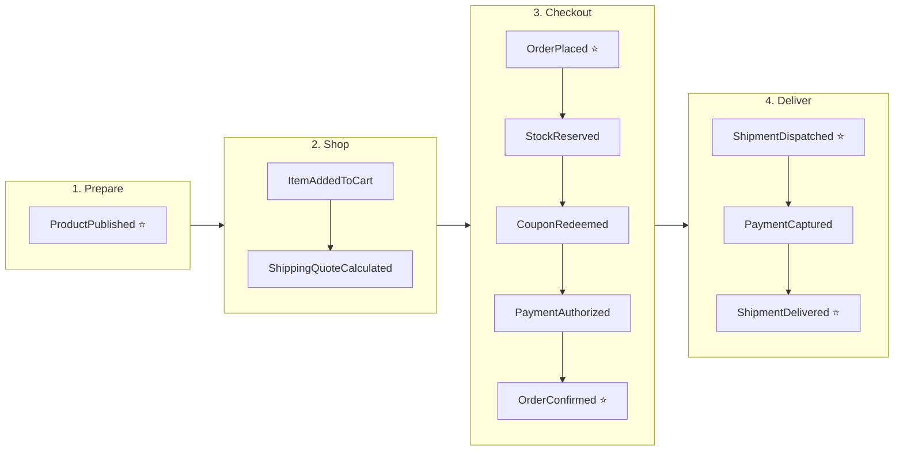
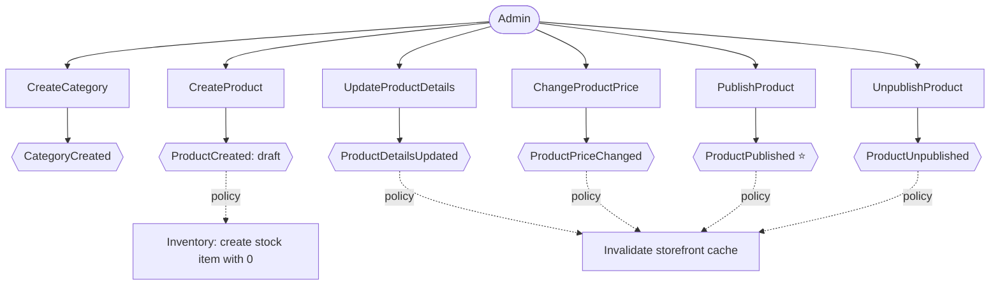
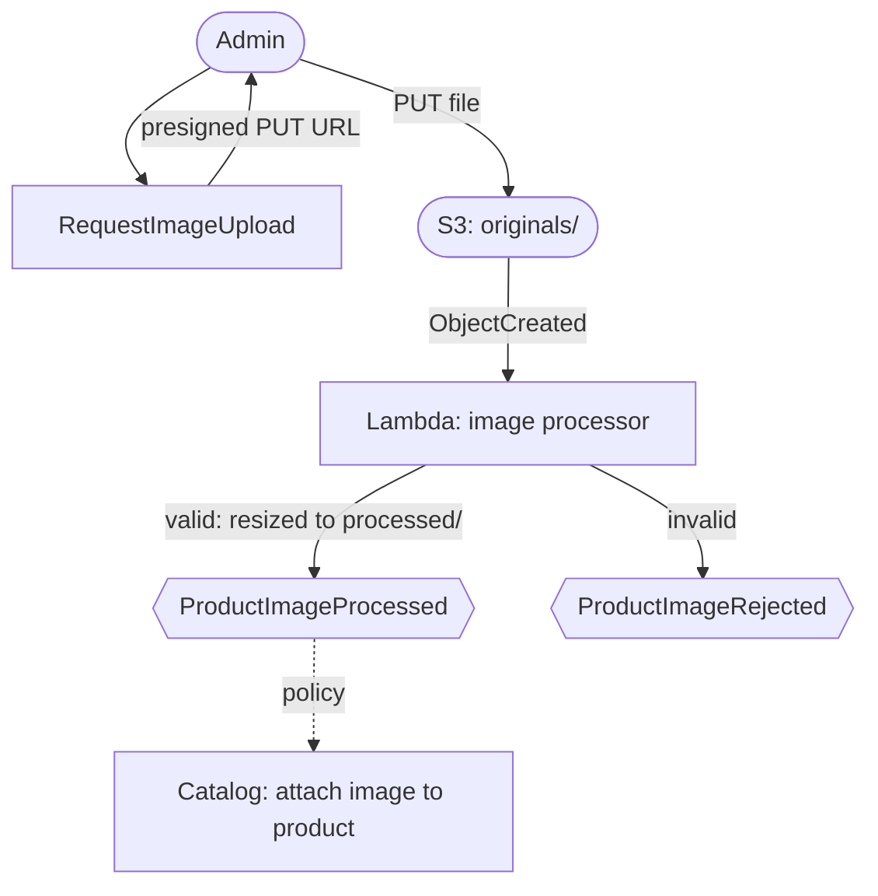
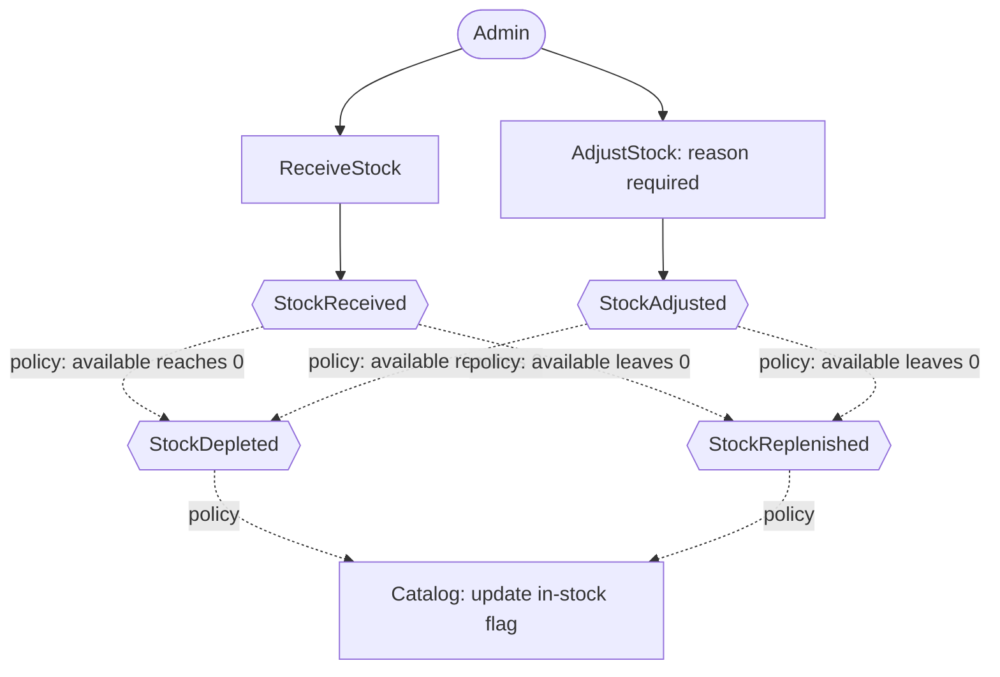
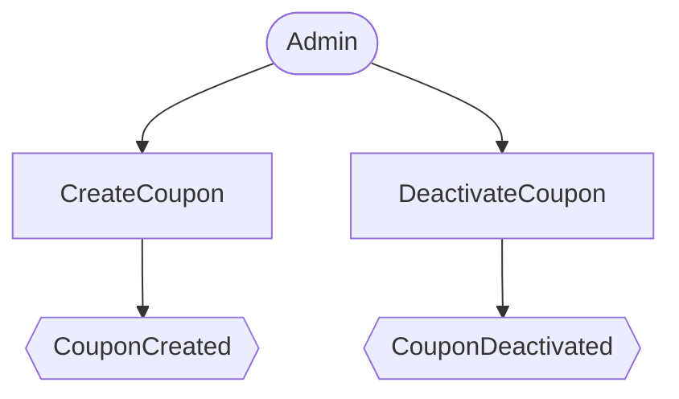
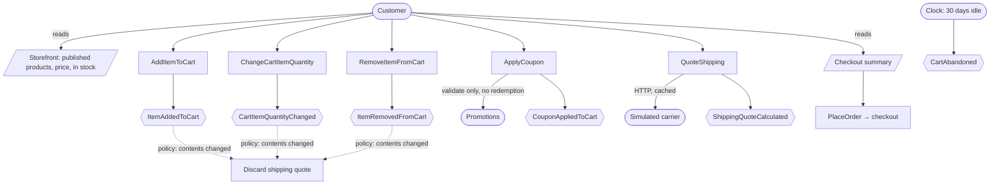
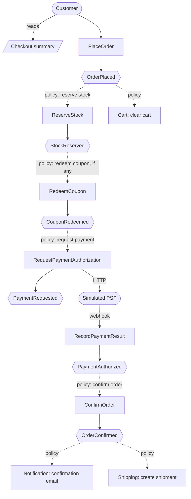
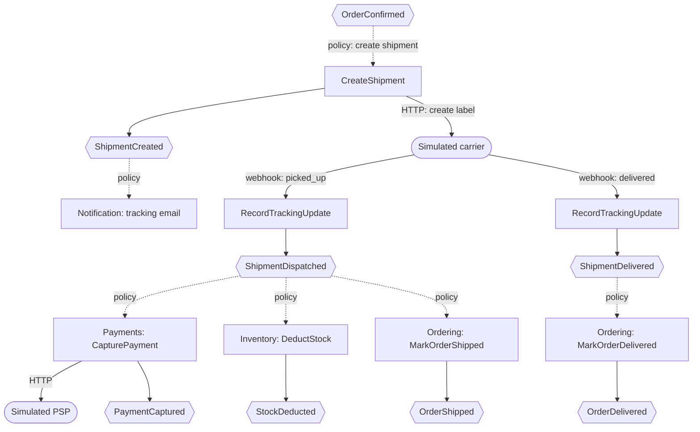
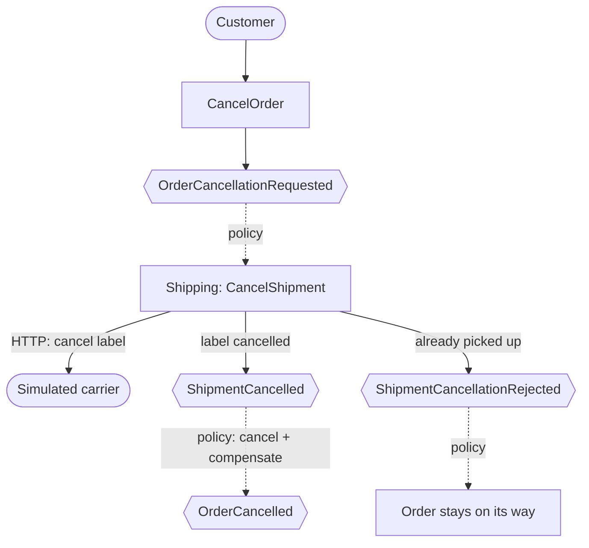
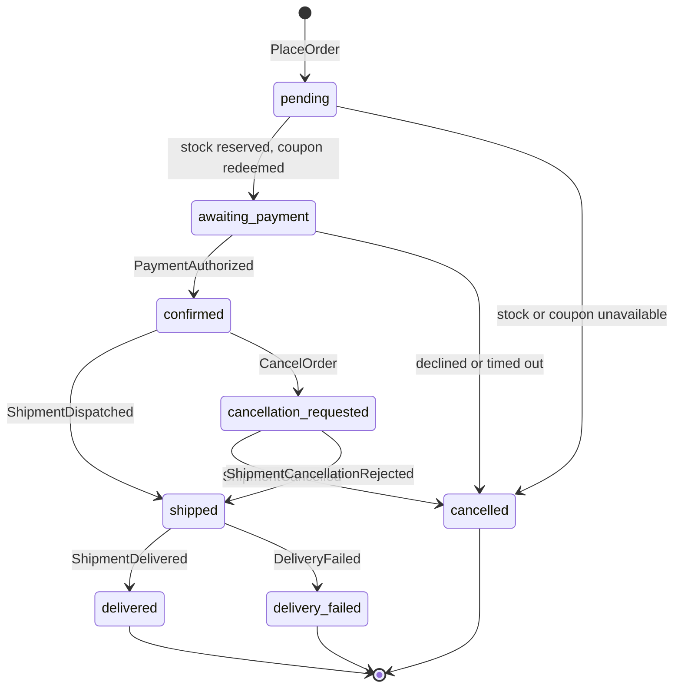

# E-commerce — Event Storming

Domain discovery for the whole e-commerce, done in three passes:

1. **Big picture** — domain events on a timeline, hotspots, pivotal events, candidate bounded contexts. ✅
2. **Process level** — commands, actors, policies, read models, external systems. 🟡 Catalog, cart, checkout and delivery done; reporting is modeled when it is built
3. **Design level** — aggregates, invariants, service boundaries, sync vs async. ⬜

Identity is already modeled in [`identity.md`](identity.md).

## Scope

| Topic        | Decision                                                                                      |
| ------------ | --------------------------------------------------------------------------------------------- |
| Business     | **Single store**: one seller, own catalog, own stock (not a marketplace).                     |
| Customers    | **Signed-in users only**: carts and orders always belong to a `userId`.                       |
| Payment      | **Simulated payment service provider (PSP)**: an external fake with controllable failures.    |
| Shipping     | **Simulated carrier**: an external fake for quotes, labels and tracking webhooks.             |
| Extras       | Coupons, product image upload (S3), sales reports (S3).                                       |
| Out of scope | Returns and refunds after delivery, marketplace sellers, guest checkout, multiple warehouses. |

## Timeline (big picture)

⭐ = **pivotal event** (the business changes phase; responsibility moves to another area).

### 1. Prepare the store (admin)

- `CategoryCreated`, `ProductCreated`, `ProductDetailsUpdated`, `ProductPriceChanged`
- `ProductImageUploaded` → `ProductImageProcessed`
- ⭐ `ProductPublished`, `ProductUnpublished`
- `StockReceived`, `StockAdjusted`
- `CouponCreated`, `CouponDeactivated`

### 2. Shop

- `ItemAddedToCart`, `CartItemQuantityChanged`, `ItemRemovedFromCart`
- `CouponAppliedToCart`, `CouponRemovedFromCart`
- `ShippingQuoteCalculated`
- `CartAbandoned` (expired by TTL)

### 3. Checkout

- ⭐ `OrderPlaced` (prices, product names and shipping are snapshotted here)
- `StockReserved` / `StockReservationFailed`
- `CouponRedeemed` / `CouponRedemptionReleased`
- `PaymentRequested` → `PaymentAuthorized` / `PaymentDeclined` / `PaymentTimedOut`
- ⭐ `OrderConfirmed` — or `OrderCancelled` with compensations: `StockReservationReleased`, `CouponRedemptionReleased`, `PaymentVoided`

### 4. Deliver

- `ShipmentCreated` → ⭐ `ShipmentDispatched` → ⭐ `ShipmentDelivered` / `DeliveryFailed`
- `PaymentCaptured` / `PaymentCaptureFailed`, `StockDeducted` (on dispatch)
- `OrderShipped`, `OrderDelivered`

### 5. Operate

- `OrderCancellationRequested` (only before dispatch) → `ShipmentCancelled` / `ShipmentCancellationRejected` → `OrderCancelled` + `PaymentVoided`
- `StockDepleted` / `StockReplenished`
- `SalesReportRequested` → `SalesReportGenerated`

## Hotspot decisions

| #   | Hotspot                              | Decision                                                                                                                                                                                                      | Technical consequence                                                                                                                                              |
| --- | ------------------------------------ | ------------------------------------------------------------------------------------------------------------------------------------------------------------------------------------------------------------- | ------------------------------------------------------------------------------------------------------------------------------------------------------------------ |
| 1   | When is stock reserved?              | On `OrderPlaced`, never on add-to-cart.                                                                                                                                                                       | Cart never touches stock; reservation is the first saga step.                                                                                                      |
| 2   | Which price applies?                 | Snapshot taken on `OrderPlaced`.                                                                                                                                                                              | Ordering keeps its own copy of price and name — deliberate duplication across contexts.                                                                            |
| 3   | Authorize and capture together?      | **Separate**: authorize at checkout, capture on `ShipmentDispatched`.                                                                                                                                         | Cancelling before dispatch is a **void**, not a refund — there is no refund path at all.                                                                           |
| 4   | PSP does not answer                  | PSP answers **asynchronously via webhook**. No answer within **15 minutes** ⇒ `PaymentTimedOut` ⇒ `OrderCancelled` + compensations. An approval arriving after the cancellation is **voided**, never ignored. | Saga timers, race between webhook and timeout, idempotent webhook handling.                                                                                        |
| 5   | Coupon usage limit under concurrency | **DynamoDB conditional write** (`used < maxUses`). Per-user limit: redemption item keyed by coupon + user with `attribute_not_exists`.                                                                        | Atomic check-and-increment without locks; both writes can go in one `TransactWriteItems`.                                                                          |
| 6   | Customer cancellation and returns    | Cancellation allowed **until dispatch**. Returns are **out of scope**.                                                                                                                                        | A customer cancellation triggers the same compensations as a failed checkout.                                                                                      |
| 7   | Shipping cost                        | **Simulated carrier**: quotes over HTTP, configurable latency/failures, tracking webhooks.                                                                                                                    | Exercises timeouts, retry with backoff, circuit breaker (module 5) and quote caching in Redis (module 6). Webhooks drive `ShipmentDispatched`/`ShipmentDelivered`. |
| 8   | Where do reports read from?          | Reporting builds **its own read model from events**.                                                                                                                                                          | CQRS projection; no service reads another service's database.                                                                                                      |

## Candidate bounded contexts

Not yet decided which ones become separate services and which are merged — that is the design-level pass.

| Context          | Owns                                                     | Status    |
| ---------------- | -------------------------------------------------------- | --------- |
| **Identity**     | Users, sessions, credentials                             | Built     |
| **Catalog**      | Categories, products, prices, images, publication        | Candidate |
| **Inventory**    | Stock levels, reservations, deductions                   | Candidate |
| **Promotions**   | Coupons, usage limits, redemptions                       | Candidate |
| **Cart**         | Carts of signed-in users, applied coupon, shipping quote | Candidate |
| **Ordering**     | Orders, price snapshot, checkout saga state              | Candidate |
| **Payments**     | Payment authorization, capture, void; PSP integration    | Candidate |
| **Shipping**     | Quotes, shipments, tracking; carrier integration         | Candidate |
| **Notification** | Emails triggered by commands and events                  | Built     |
| **Reporting**    | Sales read model, generated reports in S3                | Candidate |

### External systems

| System                | Integration                                                |
| --------------------- | ---------------------------------------------------------- |
| **Simulated PSP**     | Authorize / capture / void over HTTP; results via webhook. |
| **Simulated carrier** | Quotes and labels over HTTP; tracking updates via webhook. |
| **SMTP (Mailpit)**    | Email delivery from Notification.                          |

## Process level — Catalog, images, stock and coupons (admin)

The actor is the **admin** preparing the store. Mostly CRUD, with three technical points: **direct upload to S3**, a **Lambda triggered by an S3 event**, and an **authorization** question Identity does not answer yet (H20).

### Catalog

A product is **never deleted**, only unpublished: past orders and reports reference its id.

### Image upload (presigned URL + Lambda)

The file never passes through Catalog. Catalog only signs a short-lived permission (PUT this file, of this type, for 5 minutes) and the client uploads straight to S3. The Lambda re-validates the real file type from its bytes, because the declared content type cannot be trusted.

Unused presigned URLs and already-processed originals are cleaned by an **S3 lifecycle rule**, with no code.

### Stock (admin)

Available stock = physical − reserved, so checkout reservations can also trigger `StockDepleted`.

### Coupons

`CouponExpired` was removed: expiry is derived from `validUntil` at the moment of use. An event is only worth publishing when someone reacts to it.

### Read models

| Read model                                 | Used by  | Note                                                  |
| ------------------------------------------ | -------- | ----------------------------------------------------- |
| **Storefront** (list by category + detail) | Customer | Heavy, repetitive reads: target of Redis cache-aside. |
| **Products (admin)**                       | Admin    | Includes drafts and unpublished products.             |
| **Stock (admin)**                          | Admin    | Physical, reserved and available per product.         |
| **Coupons (admin)**                        | Admin    | Uses consumed vs limit.                               |

### Business rules

| #   | Rule                                                                                                                                                                                          | Technical consequence                           |
| --- | --------------------------------------------------------------------------------------------------------------------------------------------------------------------------------------------- | ----------------------------------------------- |
| K1  | Product lifecycle: `draft → published ⇄ unpublished`. **Never deleted.**                                                                                                                      | History preserved; no `DELETE`.                 |
| K2  | Publishing requires a name, price > 0, a category and **at least one processed image**.                                                                                                       | Invariant of the `Product` aggregate.           |
| K3  | **Single currency (BRL)**, price in cents.                                                                                                                                                    | No exchange rates.                              |
| K4  | Images: JPEG, PNG or WebP, **≤ 5 MB**, **≤ 8 per product**, uploaded through a presigned URL and validated by the Lambda.                                                                     | S3 + Lambda (module 8).                         |
| K5  | Originals are deleted by a lifecycle rule after 1 day.                                                                                                                                        | Cleanup without code.                           |
| K6  | A stock item is created with 0 on `ProductCreated`. Adjustments require a reason. **Stock never goes negative.**                                                                              | First policy between Catalog and Inventory.     |
| K7  | Coupon: percentage or fixed amount, optional minimum subtotal, validity window, global limit and **per-user limit (default 1)**. Code unique and case-insensitive. Deactivation is permanent. | Fits DynamoDB `TransactWriteItems` (hotspot 5). |
| K8  | **No `CouponExpired`**: expiry is derived from `validUntil`.                                                                                                                                  | Fewer events without consumers.                 |
| K9  | The storefront only **filters by category**, with cursor pagination. Full-text search is out of scope.                                                                                        | Scope control (search would mean OpenSearch).   |

### Technical hotspots (for the design-level pass)

| #   | Question                                                                                                                       |
| --- | ------------------------------------------------------------------------------------------------------------------------------ |
| H20 | Who is an admin? Identity has no roles and the JWT carries no `role`.                                                          |
| H21 | Storefront cache: keys, TTL, event-driven invalidation and stampede protection.                                                |
| H22 | Image processing in the Lambda: library (`sharp` is native: `allowBuilds` + Linux binary) and how processed images are served. |
| H23 | Where stock lives: Postgres (conditional `UPDATE`) or DynamoDB (conditional writes, like coupons)?                             |

## Process level — Cart and shipping quote

Unlike checkout and delivery (event-driven writes), the cart is **read-heavy** and shows data owned by other contexts: prices (Catalog), availability (Inventory), coupons (Promotions) and shipping (carrier). The central question is how a context shows data it does not own.

### Key ideas

- **The cart stores references, not copies.** Only `productId` + quantity; prices are read fresh from Catalog and become a copy only on `OrderPlaced`.
- **Availability is eventually consistent.** The storefront's "out of stock" flag comes from Inventory's `StockDepleted`/`StockReplenished` events and may lag by seconds. Checks on the read side are a convenience; the guarantee is the stock reservation on the write side.
- **The carrier is slow and may fail.** The quote is a synchronous call to an external system: home of timeouts, retry with backoff and circuit breaker (module 5) and of quote caching in Redis (module 6).

### Business rules

| #   | Rule                                                                                                                                                                                      | Technical consequence                                                        |
| --- | ----------------------------------------------------------------------------------------------------------------------------------------------------------------------------------------- | ---------------------------------------------------------------------------- |
| C1  | The cart stores **only `productId` + quantity**; the price is read fresh until the `OrderPlaced` snapshot.                                                                                | No duplicated data in the cart; the summary needs prices (H9).               |
| C2  | At most **10 units per product** and **50 distinct products** per cart.                                                                                                                   | Simple invariant of the `Cart` aggregate; also limits abuse.                 |
| C3  | Out-of-stock or unpublished products **cannot be added**. An item that becomes unavailable later stays in the cart **flagged**, and `PlaceOrder` answers `422` while any item is flagged. | Soft check on read, real guarantee on reservation.                           |
| C4  | **One coupon per cart.** Applying it only **validates**; it is consumed at checkout.                                                                                                      | The preview reserves nothing; redemption is a saga step.                     |
| C5  | The shipping quote is **bound to the cart contents and the zip code**: any item change discards it.                                                                                       | Internal cart policy; quotes are valid for 30 minutes (R3).                  |
| C6  | Carrier unavailable: **no fallback price**. Quoting answers `503` + `Retry-After`; no quote, no checkout.                                                                                 | An open circuit breaker becomes a clear answer instead of an invented price. |
| C7  | A cart **expires after 30 days without changes**; no reminder email.                                                                                                                      | Native TTL; abandoned-cart emails are out of scope.                          |

### Technical hotspots (for the design-level pass)

| #   | Question                                                                                                   |
| --- | ---------------------------------------------------------------------------------------------------------- |
| H16 | Where does the cart live: DynamoDB with TTL, Redis, or Postgres?                                           |
| H17 | Storefront availability: does Catalog keep an in-stock copy fed by events, or ask Inventory on every read? |
| H18 | Quote cache key and invalidation: zip + weight + dimensions? How long is a cached quote valid?             |
| H19 | Coupon validation on `ApplyCoupon`: synchronous call to Promotions, or a local copy of coupon rules?       |

## Process level — Checkout

Notation: **command** (intent) → **event** (fact) → **policy** ("whenever X, do Y", becomes a consumer or a saga step) → next command. Actors are the customer, external systems and the clock.

### Happy path

Steps are ordered from cheapest to most expensive to undo: stock and coupons are ours and fast to release; the payment is external, slow (webhook) and undone through a void in another system, so it comes last.

### Failures and compensations

Each failure undoes only what was already done, in reverse order.

| Failure                                                                                              | Compensations                               | Result                                     |
| ---------------------------------------------------------------------------------------------------- | ------------------------------------------- | ------------------------------------------ |
| `StockReservationFailed`                                                                             | None (first step)                           | `OrderCancelled` (`OUT_OF_STOCK`)          |
| `CouponRedemptionRejected`                                                                           | Release stock                               | `OrderCancelled` (`COUPON_UNAVAILABLE`)    |
| `PaymentDeclined`                                                                                    | Release coupon, release stock               | `OrderCancelled` (`PAYMENT_DECLINED`)      |
| `PaymentTimedOut` (actor: clock, 15 min)                                                             | Release coupon, release stock               | `OrderCancelled` (`PAYMENT_TIMEOUT`)       |
| `PaymentAuthorized` arrives after the order was cancelled                                            | `VoidPayment` ⇒ `PaymentVoided`             | Customer's money is released               |
| `ShipmentCancelled` after a customer cancellation request (see [Delivery](#process-level--delivery)) | Void payment, release coupon, release stock | `OrderCancelled` (`CANCELLED_BY_CUSTOMER`) |

The full order state machine is in [Order lifecycle](#order-lifecycle).

### Read models

| Read model           | Used by  | Purpose                                                                                                          |
| -------------------- | -------- | ---------------------------------------------------------------------------------------------------------------- |
| **Checkout summary** | Customer | Items with current prices, shipping quote and discount preview, to decide whether to place the order.            |
| **Order status**     | Customer | `GET /v1/orders/{orderId}`. `PlaceOrder` answers `202 Accepted`; the client polls until `confirmed`/`cancelled`. |
| **My orders**        | Customer | Cursor-paginated list of the customer's orders.                                                                  |

### Business rules

| #   | Rule                                                                                               | Technical consequence                                    |
| --- | -------------------------------------------------------------------------------------------------- | -------------------------------------------------------- |
| R1  | Stock is **all or nothing**: if one item is short, the whole order fails (no partial fulfillment). | One atomic reservation per order.                        |
| R2  | A coupon rejected at redemption **cancels the order** instead of charging without the discount.    | Simplest compensation; never charge more than agreed.    |
| R3  | A shipping quote is **valid for 30 minutes**; an expired quote makes `PlaceOrder` answer `422`.    | Natural TTL for the quote cache in Redis.                |
| R4  | The cart is **emptied on `OrderPlaced`** and not restored if the order is cancelled.               | Simple policy: Cart consumes `OrderPlaced`.              |
| R5  | `PlaceOrder` accepts an **`Idempotency-Key`**.                                                     | A double click or client retry never creates two orders. |

### Technical hotspots (for the design-level pass)

| #   | Question                                                                                                                                          |
| --- | ------------------------------------------------------------------------------------------------------------------------------------------------- |
| H9  | Where does the checkout price come from: a synchronous call to Catalog, or a local copy kept up to date by events (event-carried state transfer)? |
| H10 | Who coordinates the saga: choreography (services react to each other's events) or orchestration (Step Functions drives the steps)?                |
| H11 | Who owns the 15-minute payment timer: Payments, the orchestrator, or a sweeper job?                                                               |
| H12 | If the saga dies midway, a stock reservation could stay locked forever. Proposal: reservations carry their **own expiry** as a safety net.        |

## Process level — Delivery

Starts at `OrderConfirmed` and ends when the parcel is delivered (or delivery fails). The main actor is the **simulated carrier**: we call it over HTTP (create/cancel label) and it calls us back through webhooks (picked up, delivered, failed).

### Happy path

`ShipmentDispatched` fans out to three policies in three services; Shipping does not know they exist (SNS → one SQS queue per consumer).

### Customer cancellation vs pickup

Only the carrier knows whether the parcel was already picked up, so a cancellation is a **request** that the carrier decides. The intermediate state is the honest price of the truth living in an external system.

### Hard paths

| Situation                                 | Handling                                                                                                                                         |
| ----------------------------------------- | ------------------------------------------------------------------------------------------------------------------------------------------------ |
| Carrier is down when creating the label   | Message returns to the queue and is retried. The order stays `confirmed`; nothing is cancelled (the customer already paid, the problem is ours). |
| Capture fails after dispatch              | Retry with backoff; if it keeps failing, DLQ + `PaymentCaptureFailed` for manual handling (out of scope). No automatic compensation: goods left. |
| Carrier cannot deliver (`DeliveryFailed`) | Order moves to `delivery_failed` and the customer is notified. Re-delivery and return to sender are out of scope.                                |

### Read models

| Read model                    | Used by  | Purpose                                          |
| ----------------------------- | -------- | ------------------------------------------------ |
| **Order status** (extended)   | Customer | Adds the tracking code and the delivery history. |
| **Shipments awaiting pickup** | Admin    | Optional, operational view.                      |

### Business rules

| #   | Rule                                                                                                                                                 | Technical consequence                    |
| --- | ---------------------------------------------------------------------------------------------------------------------------------------------------- | ---------------------------------------- |
| D1  | The shipment is created **automatically** on `OrderConfirmed` (no manual picking step).                                                              | Fully event-driven flow.                 |
| D2  | **Capture and stock deduction happen on dispatch.**                                                                                                  | One event fanned out to three consumers. |
| D3  | A customer cancellation is a **request**; the carrier decides.                                                                                       | Intermediate state + external HTTP call. |
| D4  | A payment authorization is **valid for 7 days**. Capture failure: retry, then DLQ + `PaymentCaptureFailed`.                                          | Retry with backoff; DLQ as an alarm.     |
| D5  | `DeliveryFailed` only marks the order and notifies. Re-delivery is out of scope.                                                                     | Scope control.                           |
| D6  | **No `OrderCompleted`**: `delivered` is the final state. "Completed" only differs from "delivered" by a return window, and returns are out of scope. | A state with no rule is noise.           |

### Technical hotspots (for the design-level pass)

| #   | Question                                                                                                                           |
| --- | ---------------------------------------------------------------------------------------------------------------------------------- |
| H13 | Webhooks are public entry points: how do we authenticate the carrier and the PSP (e.g. HMAC signatures)?                           |
| H14 | Webhooks can arrive duplicated and out of order (`delivered` before `picked_up`): how are they deduplicated and ordered?           |
| H15 | Webhook fast, processing slow: acknowledge with `200` and process asynchronously (webhook → queue), or process inside the request? |

## Order lifecycle

The `Order` aggregate rejects a cancellation once the order is `shipped` (`OrderAlreadyShippedError`).
