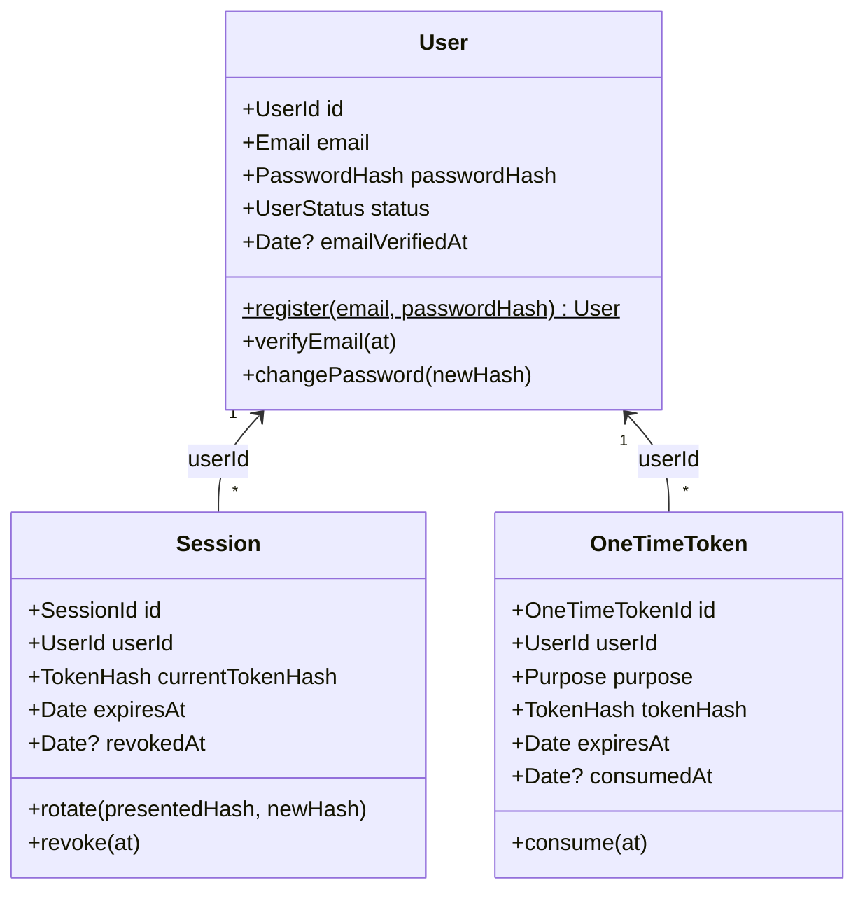
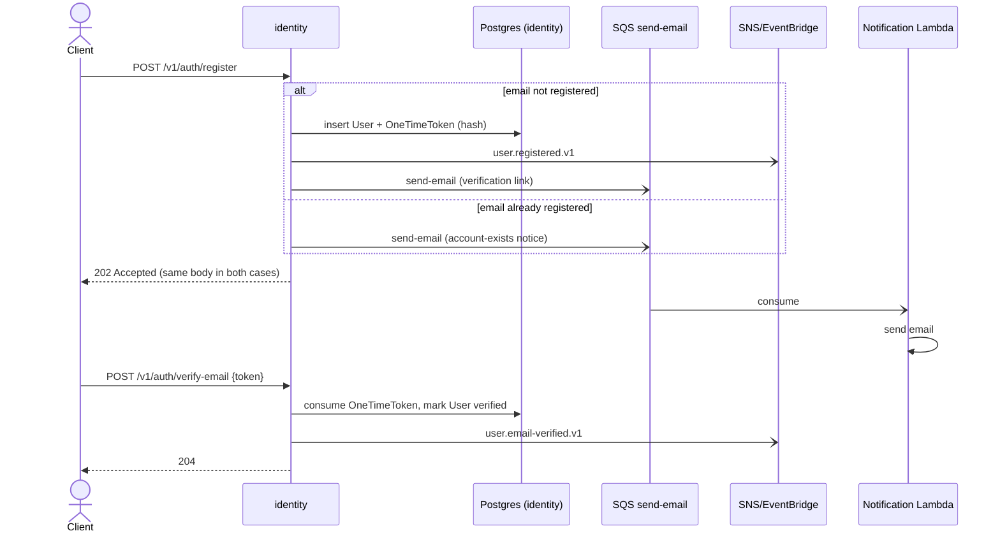
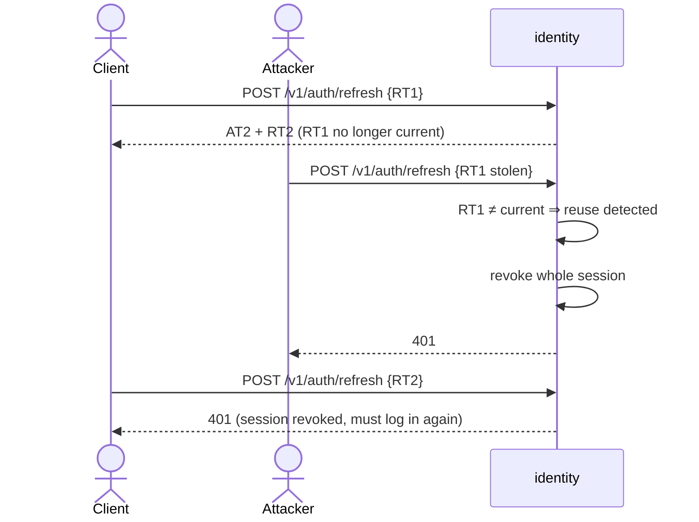
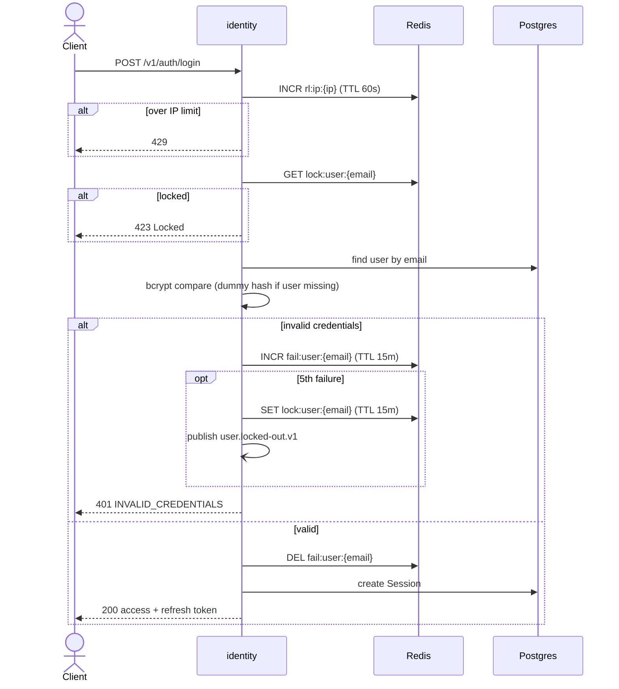

# Identity — Domain Model

Bounded context responsible for **authentication**: registering users, verifying emails, issuing and rotating tokens, and recovering passwords. **Authorization** (what a user may do) belongs to each service. See [ADR 0007](../adr/0007-identity-and-authentication.md).

## Ubiquitous language

| Term               | Meaning                                                                |
| ------------------ | ---------------------------------------------------------------------- |
| **User**           | A person with credentials in the platform.                             |
| **Session**        | A token family created at login; holds the current refresh token hash. |
| **Access token**   | Short-lived ES256 JWT used to call services.                           |
| **Refresh token**  | Opaque, single-use secret exchanged for a new token pair.              |
| **One-time token** | Single-use secret for email verification or password reset.            |
| **Lockout**        | Temporary block of an account after repeated login failures.           |

## Aggregates

- `UserStatus`: `pending_verification` → `active` → `disabled`.
- `Purpose`: `email_verification` (expires in 24 h) | `password_reset` (expires in 30 min).
- Aggregates reference each other **by id only**.

## Invariants

1. `Email` is trimmed, lowercased and unique.
2. Passwords are 8 characters to 72 UTF-8 bytes; the domain only ever holds a `PasswordHash`.
3. Verifying an already-verified email is a no-op (idempotent).
4. `Session.rotate` with a hash different from `currentTokenHash` ⇒ the session is **revoked** (reuse detection) and the operation fails.
5. A revoked or expired session cannot be rotated.
6. A one-time token can be consumed once, and only before `expiresAt`.
7. Changing the password revokes every session of the user.

## Domain events

All events use the CloudEvents envelope and contain **no secrets**.

| Type                                                      | Emitted when                              | Data                    |
| --------------------------------------------------------- | ----------------------------------------- | ----------------------- |
| `com.ecommerce.identity.user.registered.v1`               | A new user is created                     | `userId`, `email`       |
| `com.ecommerce.identity.user.email-verified.v1`           | The email is verified                     | `userId`                |
| `com.ecommerce.identity.user.password-reset-requested.v1` | A reset is requested for an existing user | `userId`                |
| `com.ecommerce.identity.user.password-changed.v1`         | The password is reset or changed          | `userId`                |
| `com.ecommerce.identity.user.locked-out.v1`               | The failure threshold is reached          | `userId`, `lockedUntil` |

## Commands sent

| Command                                             | Queue                                      | Consumer            |
| --------------------------------------------------- | ------------------------------------------ | ------------------- |
| `send-email` (template + recipient + one-time link) | `ecommerce-notifications-send-email-queue` | Notification Lambda |

## HTTP API

| Method | Path                       | Auth           | Success              |
| ------ | -------------------------- | -------------- | -------------------- |
| `POST` | `/v1/auth/register`        | —              | `202` (neutral)      |
| `POST` | `/v1/auth/login`           | —              | `200` token pair     |
| `POST` | `/v1/auth/refresh`         | refresh token  | `200` new token pair |
| `POST` | `/v1/auth/logout`          | refresh token  | `204`                |
| `POST` | `/v1/auth/verify-email`    | one-time token | `204`                |
| `POST` | `/v1/auth/forgot-password` | —              | `202` (neutral)      |
| `POST` | `/v1/auth/reset-password`  | one-time token | `204`                |
| `GET`  | `/v1/users/me`             | access token   | `200`                |
| `GET`  | `/.well-known/jwks.json`   | —              | `200` JWKS           |

Access token claims: `sub` (user id), `email`, `emailVerified`, `iat`, `exp`, `iss`, `aud`, header `kid`.

## Key flows

### Registration and email verification

### Refresh token rotation and reuse detection

### Login with brute-force protection

## Open questions

- **Reliable publishing:** the user insert and the event/command publication must be atomic → Transactional Outbox (to be decided in its own ADR).
- **Email delivery in local env:** LocalStack SES vs MailHog.
